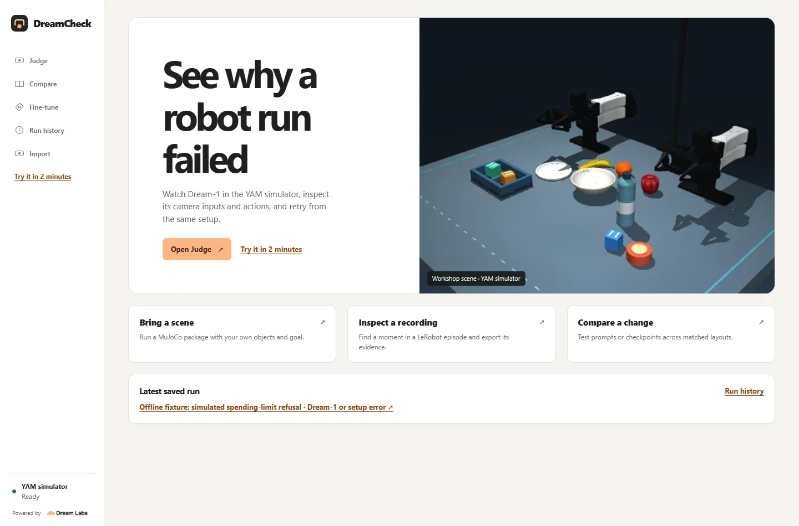
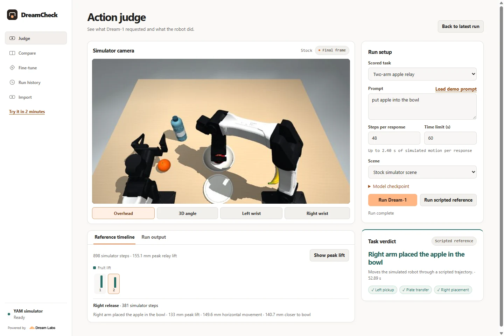
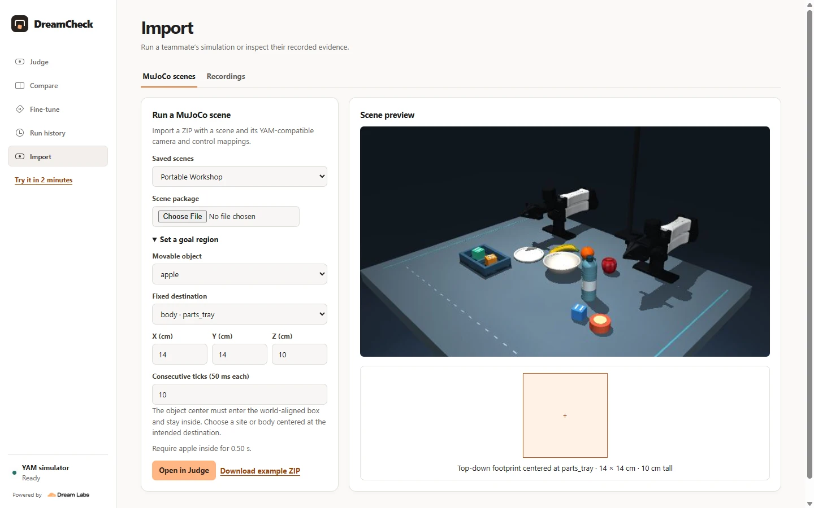
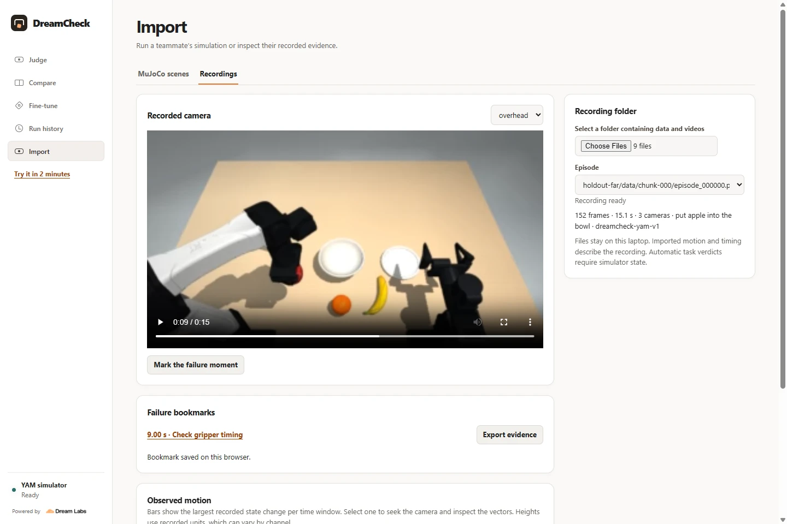

# DreamCheck

DreamCheck helps Dream-1 users see where a robot task failed and measure whether a change fixes it. It runs locally with the YAM MuJoCo simulator. No physical robot is required.

[](dreamcheck/docs/TWO_MINUTE_GUIDE.md)

[Two-minute new-user guide](dreamcheck/docs/TWO_MINUTE_GUIDE.md) · [Interactive relay replay on localhost](http://127.0.0.1:8765/replay/index.html)

1. Open a run in **Judge** to see the physical failure stage, prepared camera inputs, and action trace.
2. Choose **Test a fix** to edit one instruction while keeping the checkpoint, starting scene, and time limit fixed.
3. Check the pass counts and paired frames in **Compare**. The same viewer opens held-out results from **Fine-tune**.
4. For a fine-tune that underperforms, run the **demonstration probe** to see where its plans leave the demonstrations, then retry with a stage gate or a plan stride.

| Workspace | What you can do |
| --- | --- |
| [Judge and Run History](dreamcheck/docs/judge/README.md) | Watch the robot, inspect requested versus applied actions, and retry a saved run. |
| [Compare](dreamcheck/docs/compare/README.md) | A/B test a prompt, action horizon, or checkpoint on matched layouts. |
| [Scene import](dreamcheck/docs/scenes/README.md) | Run a compatible MuJoCo ZIP and optionally score a goal region. |
| [Recording import](dreamcheck/docs/recordings/README.md) | Inspect LeRobot v2.1 video and telemetry, bookmark a failure, and export evidence. |
| [Fine-tune](dreamcheck/docs/training/README.md) | Prepare validated demonstrations, probe a published checkpoint against them, and evaluate it against its base model. |

[Held-out relay results](dreamcheck/docs/RELAY_EVALUATION.md) show the full loop on our own fine-tune. The relay checkpoint scored 0/20 on held-out layouts. A demonstration probe showed that it starts the wrong arm from the shared home pose and moves at about a third of the demonstrated pace. With a simulator-assisted stage gate and a faster plan playback, the same checkpoint and prompt passed 8/10 held-out trials while Dream-1 Beta passed 0/10 under the same gate. [Watch the 27-second comparison](dreamcheck/docs/demo/relay-stage-gate.mp4).

| Held-out passes, fine-tune vs Dream-1 Beta | Plain policy loop | With DreamCheck run aids |
| --- | ---: | ---: |
| Apple placement | 0/6 vs 1/6 | **6/6 vs 0/6** |
| Two-arm relay | 0/20 vs 0/20 | **8/10 vs 0/10** |
| Two-arm sorting | 0/16 vs 4/16 | **8/8 vs 4/8** |

No checkpoint was retrained. The relay and sorting follow-ups use simulator contacts for the stage gate, and the two columns use different time limits. [Protocols and caveats](dreamcheck/docs/training/README.md#results-with-the-run-aids)

[Three-minute demo and relay clips](dreamcheck/docs/demo/README.md) · [Five-minute stage presentation (PDF)](dreamcheck/docs/DreamCheck-stage.pdf)

## Quick start

Use Python 3.12 and Chrome or Edge. The quick start below targets Windows. Run these commands from the checkout root in PowerShell.

```powershell
git clone https://github.com/madhan-ssi26/DreamCheck.git
Set-Location DreamCheck
python -m venv .venv
.\.venv\Scripts\python.exe -m pip install ./dream_library
.\.venv\Scripts\python.exe -m dreamcheck serve
```

Open [DreamCheck on localhost](http://127.0.0.1:8765/), choose **Open Judge**, then select **Run scripted reference**. Watch the robot complete the task and inspect the saved evidence. This workflow needs no Dream Labs account. The [two-minute guide](dreamcheck/docs/TWO_MINUTE_GUIDE.md) walks through the two-arm relay.

For live inference, configure a Dream Labs API key using the [YAM credentials guide](dream_library/examples/yam_mujoco/README.md). Restart the server if you changed the environment after starting it. In Judge, select **Load demo prompt**, then **Run Dream-1**. Live inference uses account credits.

The [setup and troubleshooting guide](dreamcheck/docs/setup/README.md) covers the CLI, credential lookup, port conflicts, and local data. The [developer guide](dreamcheck/README.md) maps the source code, browser modules, and test commands.

## Visual walkthrough

<details>
<summary>Inspect the two-arm relay in Judge</summary>



The left arm stages the apple on a plate. The right arm picks it up and places it in the bowl. Explore the [four collapsible stages](dreamcheck/docs/TWO_MINUTE_GUIDE.md#click-through-the-same-example-on-github).

</details>

<details>
<summary>Compare two prompts on matched layouts</summary>


In this saved comparison, the candidate lifted the apple higher on average and passed fewer trials. Use **Compare frames** to inspect a pair. [Compare guide](dreamcheck/docs/compare/README.md)

</details>

<details>
<summary>Set a goal for an imported scene</summary>



Download the Workshop example ZIP from Import. Select an object and destination, preview the region, then open the scene in Judge. [Scene import guide](dreamcheck/docs/scenes/README.md)

</details>

<details>
<summary>Bookmark a moment in a recording</summary>



Pause or seek on the timeline, then choose **Mark the failure moment**. Export the selected frame and nearby telemetry from the saved bookmark. [Recording import guide](dreamcheck/docs/recordings/README.md)

</details>

## Release scope

DreamCheck is a single-user workstation app bound to IPv4 loopback. Import packages and recordings from sources you trust. A browser can view saved runs by opening a link on the same workstation. To share evidence across machines, export it from the appropriate workspace.

The built-in judge scores apple and orange placement, a two-arm apple relay through a transfer plate, and instruction-conditioned sorting of two fruits into two bays. Imported scenes require YAM-compatible controls. Recording import supports LeRobot v2.1 Parquet and matching MP4 files. Fine-tuning submission and checkpoint serving depend on the Dream Labs account and platform.

## Upstream and license

DreamCheck application code in `dreamcheck/` is available under the [MIT license](dreamcheck/LICENSE). The bundled Dream Labs SDK and patched YAM simulator retain their [Apache 2.0 license](LICENSE) and [third-party notices](dream_library/THIRD-PARTY-LICENSES.md). See the [bundled library README](dream_library/README.md) and [YAM simulator guide](dream_library/examples/yam_mujoco/README.md) for upstream documentation.
