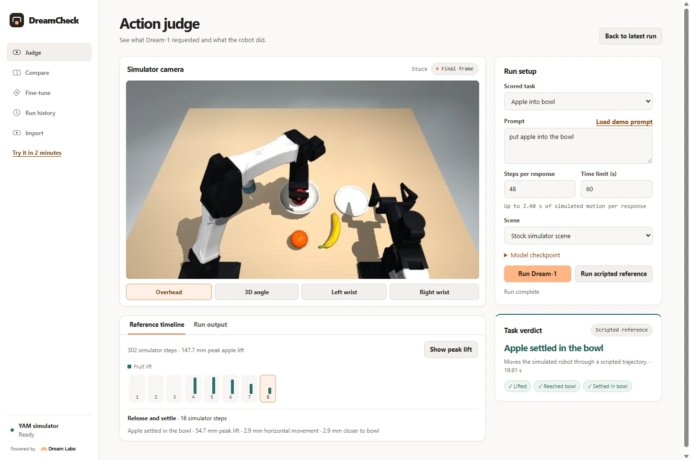
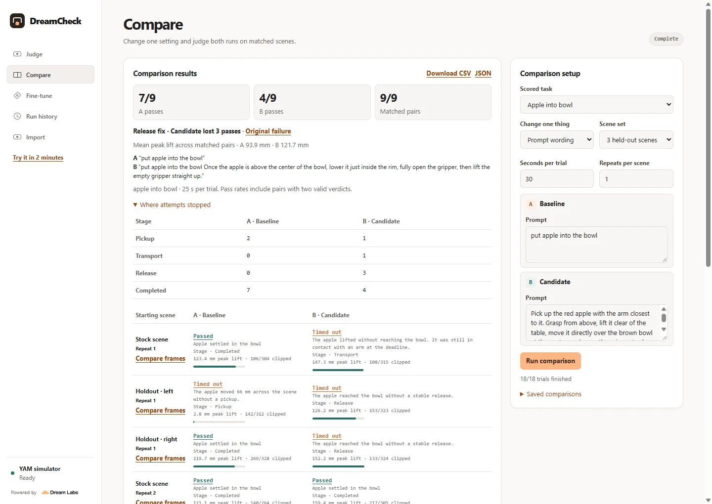

# DreamCheck

DreamCheck helps Dream-1 users see where a robot task failed, test one change from the same starting scene, and share the evidence. It runs locally with the YAM MuJoCo simulator. No physical robot is required.

[](dreamcheck/docs/judge/README.md)

| Workspace | What you can do |
| --- | --- |
| [Judge and Run History](dreamcheck/docs/judge/README.md) | Watch the robot, inspect requested versus applied actions, and retry a saved run. |
| [Compare](dreamcheck/docs/compare/README.md) | A/B test a prompt, action horizon, or checkpoint on matched layouts. |
| [Scene import](dreamcheck/docs/scenes/README.md) | Run a compatible MuJoCo ZIP and optionally score a goal region. |
| [Recording import](dreamcheck/docs/recordings/README.md) | Inspect LeRobot v2.1 video and telemetry, bookmark a failure, and export evidence. |
| [Fine-tune](dreamcheck/docs/training/README.md) | Prepare validated demonstrations and evaluate a published checkpoint against its base model. |

## Quick start

Use Python 3.12 and Chrome or Edge. The quick start below targets Windows. Run these commands from the checkout root in PowerShell.

```powershell
git clone https://github.com/madhan-ssi26/DreamCheck.git
Set-Location DreamCheck
python -m venv .venv
.\.venv\Scripts\python.exe -m pip install ./dream_library
.\.venv\Scripts\python.exe -m dreamcheck serve
```

Open [DreamCheck on localhost](http://127.0.0.1:8765/), choose **Run a scene**, then select **Run scripted reference** in Judge. Watch the arm place the fruit in the bowl and open the saved evidence. This workflow works without a Dream Labs account.

For live inference, configure a Dream Labs API key using the [YAM credentials guide](dream_library/examples/yam_mujoco/README.md). Restart the server if you changed the environment after starting it. In Judge, select **Load demo prompt**, then **Run Dream-1**. Live inference uses account credits.

The [setup and troubleshooting guide](dreamcheck/docs/setup/README.md) covers the CLI, credential lookup, port conflicts, and local data. The [developer guide](dreamcheck/README.md) maps the source code, browser modules, and test commands.

## Visual walkthrough

<details>
<summary>Compare two prompts on matched layouts</summary>



In this saved comparison, the candidate lifted the apple higher on average and passed fewer trials. Use **Compare frames** to inspect a pair. [Compare guide](dreamcheck/docs/compare/README.md)

</details>

<details>
<summary>Set a goal for an imported scene</summary>


Download the Workshop example ZIP from Import. Select an object and destination, preview the region, then open the scene in Judge. [Scene import guide](dreamcheck/docs/scenes/README.md)

</details>

<details>
<summary>Bookmark a moment in a recording</summary>


Pause or seek on the timeline, then choose **Mark the failure moment**. Export the selected frame and nearby telemetry from the saved bookmark. [Recording import guide](dreamcheck/docs/recordings/README.md)

</details>

## Release scope

DreamCheck is a single-user workstation app bound to IPv4 loopback. Import packages and recordings from sources you trust. A browser can view saved runs by opening a link on the same workstation. To share evidence across machines, export it from the appropriate workspace.

The built-in judge scores apple and orange placement. Imported scenes require YAM-compatible controls. Recording import supports LeRobot v2.1 Parquet and matching MP4 files. Fine-tuning submission and checkpoint serving depend on the Dream Labs account and platform.

## Upstream and license

DreamCheck application code in `dreamcheck/` is available under the [MIT license](dreamcheck/LICENSE). The bundled Dream Labs SDK and patched YAM simulator retain their [Apache 2.0 license](LICENSE) and [third-party notices](dream_library/THIRD-PARTY-LICENSES.md). See the [bundled library README](dream_library/README.md) and [YAM simulator guide](dream_library/examples/yam_mujoco/README.md) for upstream documentation.
