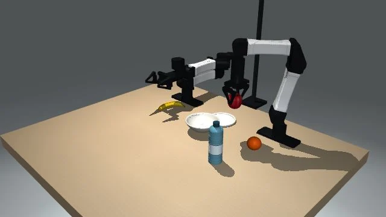
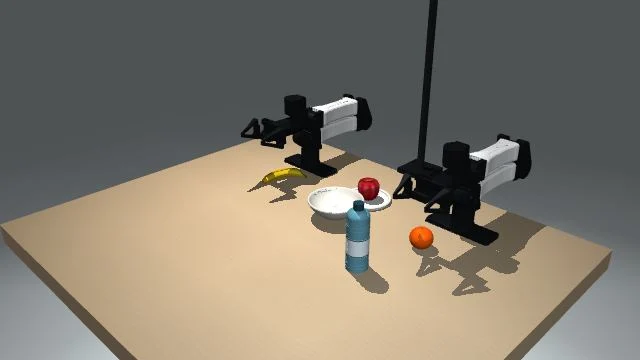
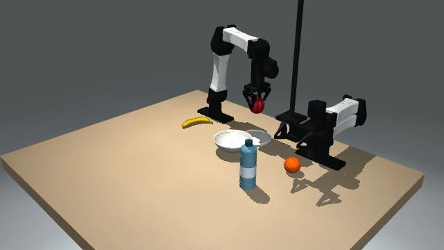
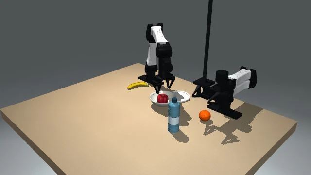

# Your first two minutes with DreamCheck

Start the local app using the [installation steps](../../README.md#quick-start). This walkthrough uses an offline reference, so it needs neither an API key nor a physical robot.

| Time | What to do | What to look for |
| --- | --- | --- |
| 0:00–0:20 | Open [Try DreamCheck](http://127.0.0.1:8765/#try), click **Open offline relay setup**, then choose **Run scripted reference**. | The left arm picks up the apple. |
| 0:20–1:10 | Watch the transfer plate and switch between **Overhead**, **3D angle**, and the wrist views. | The apple rests on the plate before the right arm takes over. |
| 1:10–2:00 | Read the **Task verdict**. Select a bar in **Reference timeline**, then try **Show peak lift**. Open the run again from **Run history**. | The verdict checks left pickup, plate transfer, and right placement. The timeline lets you revisit the evidence. |

Prefer to explore immediately? Open the [interactive replay](http://127.0.0.1:8765/replay/index.html) with the server running. Click a stage or use the left and right arrow keys when a stage button has focus.

## Click through the same example on GitHub

Left pickup

Plate transfer

Right pickup

Settled placement

## Try this with a teammate

Give them a saved timeout and the [Judge guide](judge/README.md). Ask them to find the first incomplete stage, inspect the camera inputs when available, and explain a fair retry. Use **Test a fix** to review one added instruction in Compare. The quick check uses the original starting scene for both prompts. Observe where they needed help.
