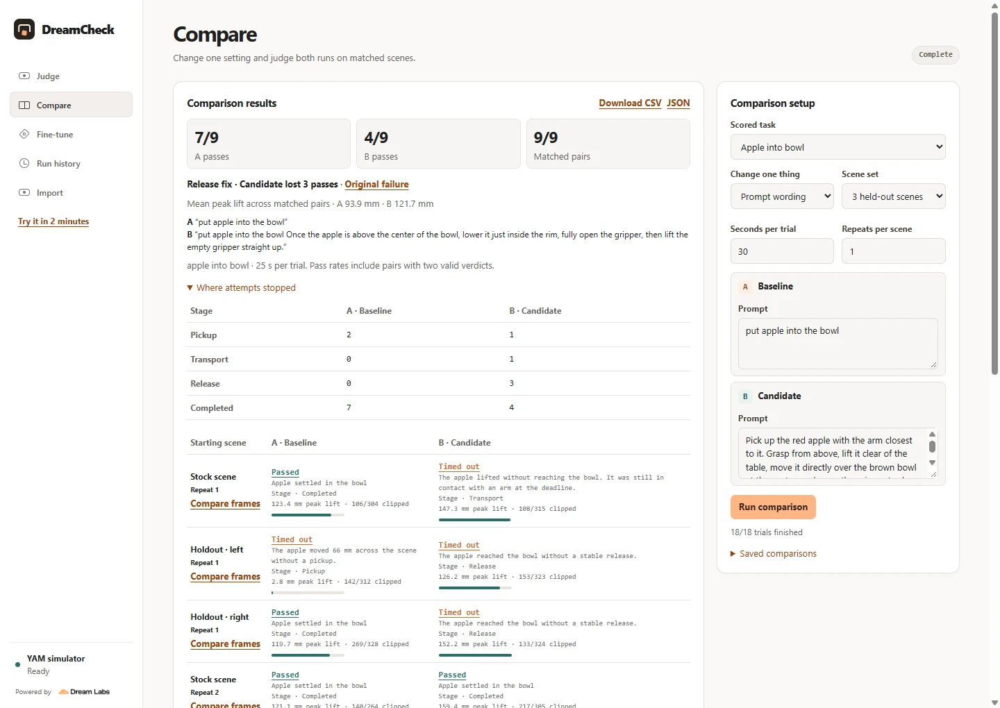

# Compare

Use Compare when you want evidence that a change helps across repeated trials. Choose a baseline and candidate, vary a prompt, checkpoint, or action horizon, and select the layouts and repeats. Confirm the number of live trials before starting. Each trial may make multiple billable Dream-1 calls.

Each pair starts from the same layout. The scheduler alternates which setting goes first and stores completed trials as it runs. For two checkpoints with different policy rates, the scheduler matches their simulated action horizon using the respective number of steps. Stock gives a quick check. Three held-out layouts give broader coverage for the built-in scene tasks.

From a scored live failure in **Judge**, pick **Test a fix**. DreamCheck suggests one instruction for the recorded failure stage, including plate transfer, right pickup, and sorting errors. Edit the candidate prompt with the original preserved as the baseline. The quick check runs both prompts from the original scene. The repeat option uses related layouts when available and preserves the requested fruit and bay for sorting.

For a relay or sorting timeout, **Test a fix** offers **Stage gate · park the idle arm** as the candidate change. Both runs keep the prompt, checkpoint, and scene, and both stop at 150 simulated seconds. Choose **Edit the prompt** to compare instructions instead. [How the gate works](../judge/README.md#run-aids-for-two-arm-checkpoints)

For an imported scene with a scored goal, **Compare a prompt edit** lets you revise the candidate prompt. Both prompts use the exact scene and goal saved with the original run.

In **Fine-tune**, choose a dataset and select **Open evaluation in Compare** to inspect its held-out trials here. For sorting, each pair shows the fruit and bay prompt shared by the two checkpoints. Return to the dataset and refresh to open the latest report.

## Interpret and export

- Review the matched pass tally and the trial count together. Matched pairs require two physical verdicts. Timeouts, wrong-bay placements, and disturbances of the unrequested fruit count as failures.
- **Compare frames** opens paired final or peak-lift frames when that evidence is available. Open either action timeline and use **Back to comparison** to return.
- Download CSV or JSON for per-trial analysis. Browser comparisons are kept in `.dreamcheck/comparisons/`. Held-out evaluations are kept in `.dreamcheck/training/`.
- **Stop comparison** preserves completed browser trials.
