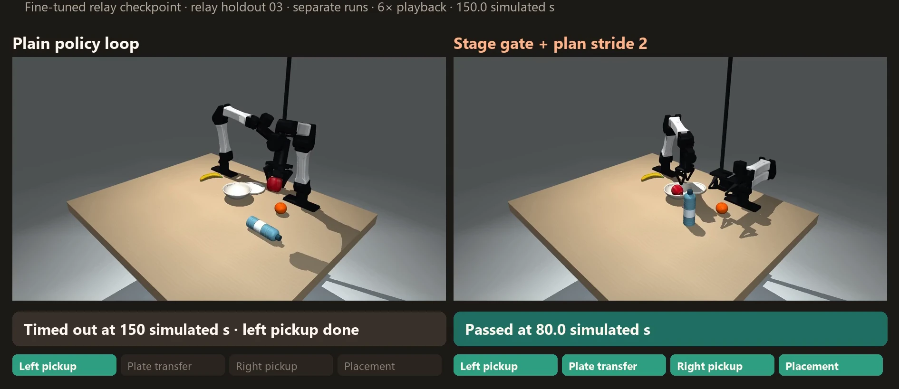

# DreamCheck videos and interactive examples

[Three-minute intro with team narration](DreamCheck-submission.mp4) · [Silent technical walkthrough](DreamCheck-technical-demo.mp4) · [PowerPoint](../DreamCheck-stage.pptx) · [PDF](../DreamCheck-stage.pdf)

The intro follows an investigation from a failed run to a measured fix. It includes the team's recorded narration over the running app and live simulator footage. Both videos are 1080p.

## Intro chapters

| Time | What it shows |
| --- | --- |
| 0:00 | The fine-tuned relay checkpoint stalling on a held-out scene |
| 0:10 | DreamCheck Home with the before-and-after scores |
| 0:21 | The failed run in Judge, played back response by response, then its camera inputs and reply timing |
| 0:47 | The demonstration probe: the checkpoint starts the wrong arm from the home pose and plans at about a third of the demonstrated pace |
| 1:12 | **Test a fix** with the stage gate as the candidate change, and its matched result |
| 1:26 | The same checkpoint, prompt, and scene with the plain loop beside the stage gate |
| 1:46 | Held-out results for relay, sorting, and apple placement over live simulator footage |
| 2:26 | What the results do and do not show |
| 2:39 | Prompt comparison, scene import, and recording bookmarks |

## Silent technical walkthrough

The 2:21 walkthrough uses on-screen cues and contains no audio track. Use it to inspect the app and the recorded outcomes at your own pace.

| Time | Feature |
| --- | --- |
| 0:00 | DreamCheck workspace |
| 0:06 | Replay a saved failure in Judge |
| 0:22 | Inspect the prepared camera windows and reply timing |
| 0:30 | Probe the checkpoint at saved demonstration states |
| 0:52 | Open **Test a fix** and inspect the stage-gate setup |
| 1:05 | Watch the 27-second plain and gated simulator runs side by side |
| 1:32 | Open the held-out relay results and individual trials |
| 1:41 | View the sorting and apple placement recordings |
| 2:03 | Inspect examples of prompt comparison, scene import, and recording bookmarks |
| 2:14 | Read the held-out counts and protocol limits |

## Interactive examples

- [Offline relay replay ZIP](DreamCheck-interactive-replay.zip). Extract the folder and open `index.html` in your browser. Click the four stages or use the left and right arrow keys. The frames come from a scripted reference and the replay needs no simulator or API key.
- [Workshop MuJoCo scene ZIP](DreamCheck-workshop-scene.zip). In the running app, upload the ZIP under **Import → MuJoCo scenes**. Preview the mapped robot and cameras, then select the blue block and parts tray to create a goal region. Preview runs locally. Starting Dream-1 inference uses your account. [Scene import guide](../scenes/README.md)

## Relay clips

- [Plain policy loop beside the stage gate (27 seconds)](relay-stage-gate.mp4). Same fine-tuned checkpoint, training prompt, and `relay-holdout-03` layout in two separate footage runs at 6× playback. The plain loop times out at 150 simulated seconds after the left pickup. With the stage gate and plan stride 2 the relay passes at 80.0 simulated seconds. The gate uses the simulator's plate-transfer check. [Results and protocol](../RELAY_EVALUATION.md#demonstration-probe-and-stage-gate)
- [Earlier side-by-side relay clip (28 seconds)](relay-demo-side-by-side.mp4) and [earlier successful checkpoint run (26 seconds)](relay-demo-success.mp4). These show a selected fine-tuned success under a longer, explicit prompt and a 600-second wall limit, recorded before the probe. The base-model excerpt comes from a separate run with the same prompt and layout.

The stage presentation covers the same investigation in six slides. Protocols and trial counts are in the [training guide](../training/README.md#results-with-the-run-aids) and the [relay evaluation](../RELAY_EVALUATION.md).

## Prompts

Every run-aid result uses the prompt the checkpoint was trained on. For the relay that is:

> Use the left arm to put the apple on the transfer plate, then use the right arm to pick it up from the plate and place it in the bowl.

The two earlier clips used this longer prompt:

> Use the left arm to pick up the apple and set it down in the center of the flat transfer plate. Open the left gripper and move the left arm clear of the plate. Once the apple is resting on the plate, use the right arm to pick it up, place it in the bowl, and open the right gripper.
