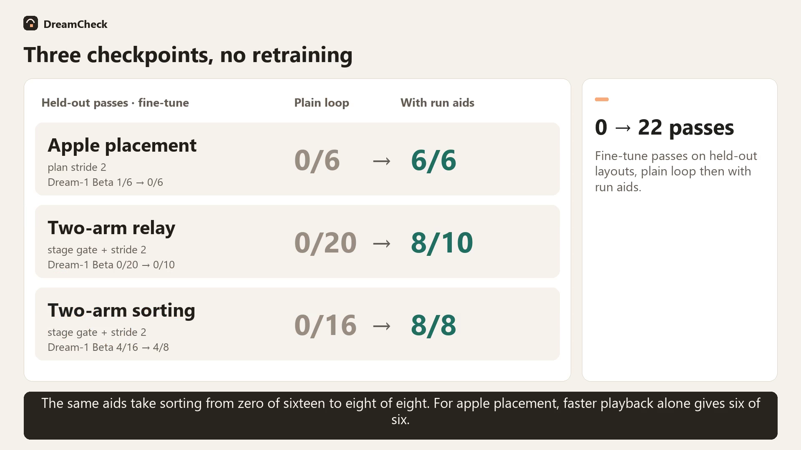

# DreamCheck demo

[Download the three-minute demo (1080p MP4)](DreamCheck-submission.mp4)

The walkthrough follows one investigation from a failed run to a measured fix. Narration is synthesized and captions are burned in.

| Time | What it shows |
| --- | --- |
| 0:00 | Three fine-tuned checkpoints that passed no held-out trial |
| 0:11 | A fine-tuned relay timeout in Judge, its action timeline, and the prepared camera inputs |
| 0:52 | The demonstration probe: the checkpoint starts the wrong arm from the home pose and plans at about a third of the demonstrated pace |
| 1:12 | **Test a fix** with the stage gate as the candidate change |
| 1:23 | The same checkpoint, prompt, and scene with the plain loop beside the stage gate |
| 1:56 | Held-out results for relay, sorting, and apple placement, followed by what they do and do not show |
| 2:30 | Prompt comparison, scene import, and recording bookmarks |

- [Plain policy loop beside the stage gate (33 seconds)](relay-stage-gate.mp4). Same fine-tuned checkpoint, training prompt, and `relay-holdout-06` layout in two separate diagnostic runs at 5× playback. The plain loop times out at 150 simulated seconds after the left pickup. With the stage gate and plan stride 2 the relay passes at 89.8 simulated seconds. The gate uses the simulator's plate-transfer check. [Results and protocol](../RELAY_EVALUATION.md#demonstration-probe-and-stage-gate)
- [Earlier side-by-side relay clip (28 seconds)](relay-demo-side-by-side.mp4) and [earlier successful checkpoint run (26 seconds)](relay-demo-success.mp4). These show a selected fine-tuned success under a longer, explicit prompt and a 600-second wall limit, recorded before the probe. The base-model excerpt comes from a separate run with the same prompt and layout.

The [stage presentation](../DreamCheck-stage.pdf) covers the same investigation in six slides. Protocols, trial counts, and limits for every number are in the [training guide](../training/README.md#results-with-the-run-aids) and the [relay evaluation](../RELAY_EVALUATION.md).

## Prompts

Every run-aid result uses the prompt the checkpoint was trained on. For the relay that is:

> Use the left arm to put the apple on the transfer plate, then use the right arm to pick it up from the plate and place it in the bowl.

The two earlier clips used this longer prompt:

> Use the left arm to pick up the apple and set it down in the center of the flat transfer plate. Open the left gripper and move the left arm clear of the plate. Once the apple is resting on the plate, use the right arm to pick it up, place it in the bowl, and open the right gripper.
