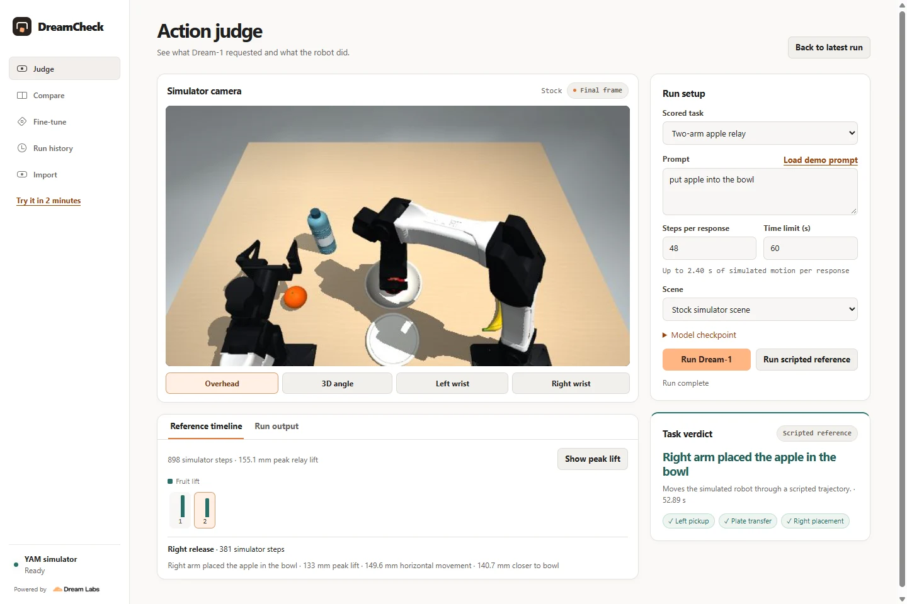

# Judge and Run History

Use the [two-minute guide](../TWO_MINUTE_GUIDE.md) for a first run or the [interactive replay](http://127.0.0.1:8765/replay/index.html) to explore saved stages before starting the simulator.

1. In **Judge**, choose **Apple into bowl**, **Orange into bowl**, **Two-arm apple relay**, or **Two-arm fruit sorting**, then select a layout. Stock is the simplest starting point for placement and relay. Workshop adds blocks, a parts tray, and another view.
2. Use **Run scripted reference** for a credential-free smoke test, or enter a prompt and choose **Run Dream-1**. Expand **Model and run settings** to change the checkpoint, executed actions per response, or wall-clock deadline.
3. Watch the overhead, overview, and wrist cameras. Click a response in **Action timeline** to see its evidence. **Show peak lift** opens a saved earlier frame when available.
4. Edit the prompt and retry, or choose the shorter-horizon retry to refresh the model more often. A retry uses the saved run's starting layout, checkpoint, time limit, and goal. The shorter variant halves the prior action horizon.

## Run aids for two-arm checkpoints

**Model and run settings** has two inference-time aids. They change how DreamCheck executes the returned plans. The checkpoint and prompt stay the same, and every saved run records which aids were on.

- **Plan stride** executes every second or third row of each plan. Use it when the [demonstration probe](../training/README.md#probe-a-checkpoint-against-its-demonstrations) shows plans that cover less distance than the demonstrations.
- **Two-arm stage gate** keeps the arm with no job in the current relay or sorting stage at its home pose. It follows DreamCheck's plate-transfer check, lets the left arm retreat, parks it, then releases the right arm. The verdict shows when the right arm was released. The stage signal comes from simulator contacts, so treat gated passes as simulator-assisted.

A gated run stops after a simulated-time budget, which keeps request latency out of the result. On a relay or sorting timeout, **Retry with stage gate** reruns the saved scene, prompt, and checkpoint with the gate on and 150 simulated seconds. **Play run** steps the camera through the saved frame of every response.

## How the judge decides

The built-in fruit scorer reads MuJoCo positions, velocity, and contacts after each executed control tick. A pass requires ten consecutive ticks in the bowl region, contact with the bowl, low speed, and no robot contact. Lift and reaching the bowl are progress signals. On a timeout, DreamCheck uses them to identify the last incomplete stage. The scripted reference runs the same physical scorer. The static offline fixture exercises a local scene while holding position.

The relay adds an ordered left-arm pickup, contact with the transfer plate while both arms are clear, then a right-arm pickup and bowl placement. The [training guide](../training/README.md) describes the separate held-out evaluation for the relay.

The timeline stores executed steps, the biggest per-joint correction in a response, the number of clipped steps, request latency, movement, and camera images. A step with several clipped joints counts once. These values describe the simulator run. An imported goal uses the separate [region rule](../scenes/README.md).

For a new live run, choose **Inspect camera inputs and first reply** in the verdict or expand **Dream-1 camera inputs and timing** below the simulator view. It shows a sample JPEG from each camera window prepared for the SDK, the request key, window length, resolution, first reply timing, and reply count. Use it to diagnose missing, swapped, or occluded views at the client boundary. A successful reply confirms the API returned. Model-side handling of individual frames is outside the captured evidence.

If Dream Labs refuses a request because the account hit its spending cap, the simulator stops executing actions, saves the previous evidence, and shows the billing reason in the verdict. Auth failures, warm-up, rate limits, and observation errors have separate messages.

## Find or share a result

Open **Run history** and filter by outcome or search by prompt, checkpoint, or scene. Recent saved runs appear after a restart. A run link reopens data stored in that checkout. To send someone a result, share the appropriate JSON and JPEG files from `.dreamcheck/runs/RUN_ID/`. For a scored live failure, use **Test a fix** or **Compare a prompt edit** to carry the run into a matched [comparison](../compare/README.md).

## Two-minute first-use check

Give a Dream-1 user a saved timeout and the **Try it in 2 minutes** guide. Ask them to identify the first incomplete physical stage, find the prepared camera inputs and timing when available, and explain what their retry changes. Observe where they click first and where they need help. Use those observations to decide if any controls need a clearer label or position.
