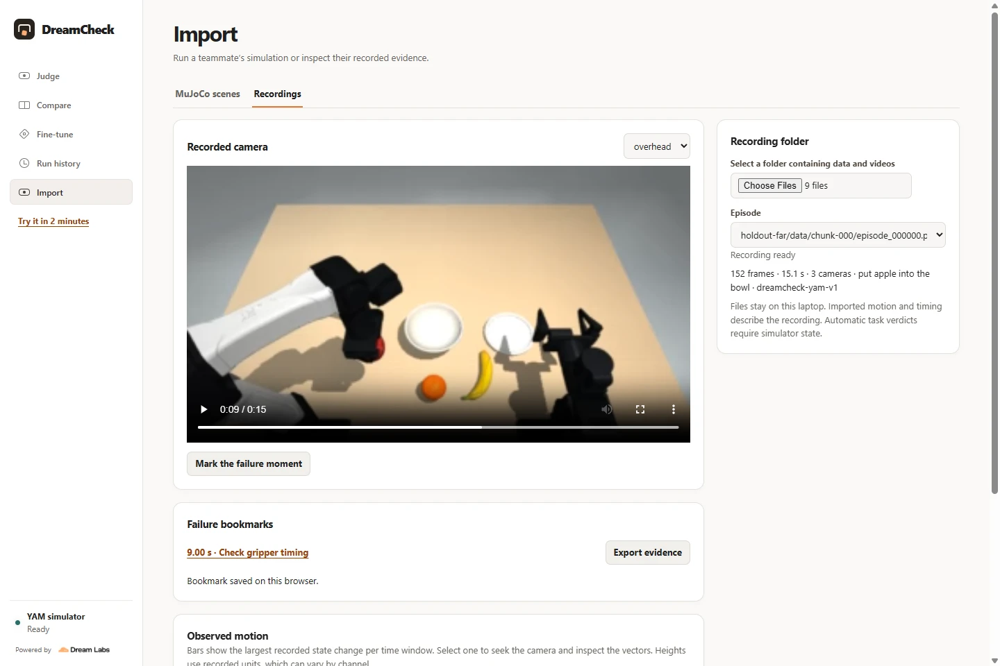

# Inspect a LeRobot recording



Open **Inspect a recording** or **Import → Recordings**, then choose the rollout or dataset folder. Use a Chromium browser that supports folder selection.

```text
dataset/
  data/chunk-000/episode_000000.parquet
  videos/chunk-000/observation.images.overhead/episode_000000.mp4
  rollout.json
  inference.jsonl
```

Choose an episode. Each camera must have a matching MP4 episode filename under the dataset's `videos/` directory. Parquet files must be at most 32 MB, contain one episode, and include ordered `timestamp` values in seconds and finite numeric `observation.state` and `action` vectors. `rollout.json` can supply the prompt, checkpoint, or body. A valid `inference.jsonl` provides median and p95 request latency for a single-episode rollout.

The motion bars show the largest state change per sampled time window in recorded units. Select a bar to seek the video and inspect the observed state and recorded action. Different channels can use different units. The importer reviews historical data and leaves task judgment to the viewer.

Pause the video and choose **Mark the failure moment**. Enter a short label and save. The bookmark reopens that camera and timestamp after you reselect the same unchanged folder in the same browser profile and URL. **Export evidence** saves one JSON containing a JPEG data URL, the nearest telemetry windows, and the prompt and checkpoint when available. The folder and camera streams stay on your machine.

To try it with simulated data, run `python -m dreamcheck train prepare` and select one generated episode folder under the bundle's `holdout/` directory. The [training guide](../training/README.md) explains how the simulator records and validates that data.
