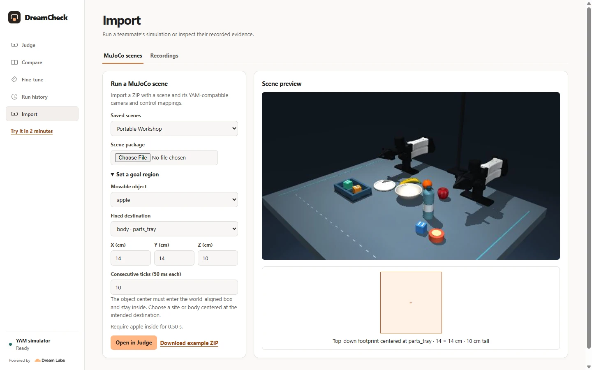

# Import a MuJoCo scene

Open **Import → MuJoCo scenes**. Download the example ZIP to try the flow or copy its mapping. Select a ZIP and wait for the compiler, servo checks, simulation tick, and camera render. Accepted packages remain available under **Saved scenes**. Select **Open in Judge**, enter a prompt, and choose Dream-1 Beta or Beta Flash.

## Package format

Put `scene.xml`, `dreamcheck.json`, and their assets in the ZIP. Use a flattened MJCF scene with ZIP-relative asset references. Imports support up to 48 MB compressed, 96 MB expanded, and 300 files. Flatten includes and attached models before exporting, and omit plugins and MJCF asset-directory directives.

| Mapping field | What to supply |
| --- | --- |
| `name` | Optional display name. |
| `cameras` | Names of the MJCF cameras used for `top`, `left`, and `right`. Add `overview` to provide a separate inspection view. |
| `arms.left`, `arms.right` | Arrays `joints` and `actuators`, each with six names in YAM joint order. Use limited hinge joints and direct unit-gear position servos. |
| Per-arm gripper | Supply `gripper_joint`, `gripper_actuator`, and `gripper_range` as `[closed, open]` in joint units. |
| `gripper_followers` | Optional per-arm list with `actuator` and `range` for secondary fingers. |
| `keyframe` | Optional reset keyframe name. |

The scene timestep must divide a 50 ms control tick into at most 100 physics substeps. Numerical validation checks the control mapping. Test the actual camera orientation, joint order, and robot motion with a short task before using results.

## Score a goal region

Open **Set a goal region** and choose a named free-joint object and a fixed site or body. The destination's initial world position is the center of an axis-aligned X/Y/Z box. Set each dimension in centimeters, preview the footprint, and choose the required consecutive 50 ms ticks. The object center must enter from outside. A departure resets the dwell count. The rule measures occupancy, so the robot can still be holding the object at success. Leave the editor closed for a manual review run. A saved retry keeps the original rule and scene.

Scene ZIPs and preview JPEGs stay in `.dreamcheck/scenes/`. Live requests send policy camera observations and robot state to Dream Labs as the run progresses.
